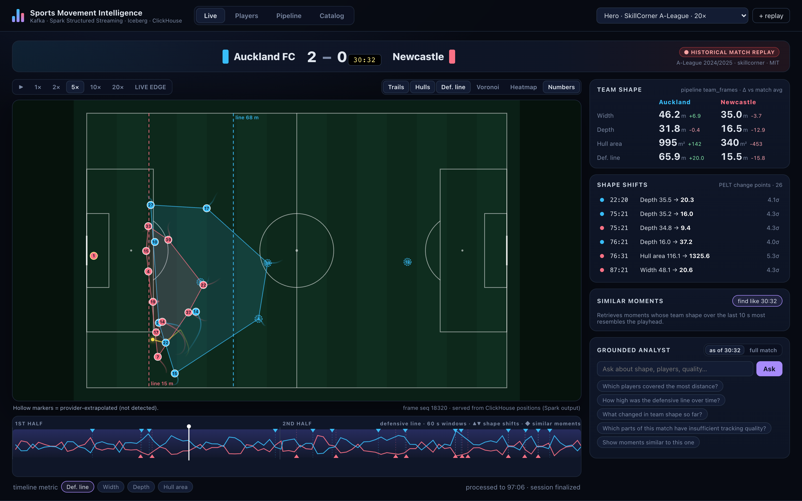
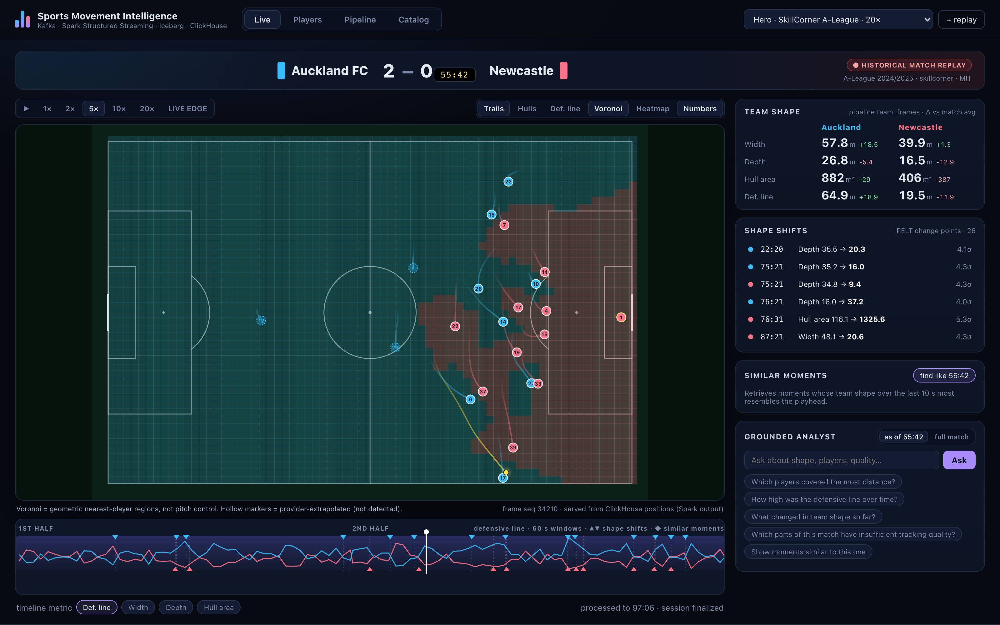
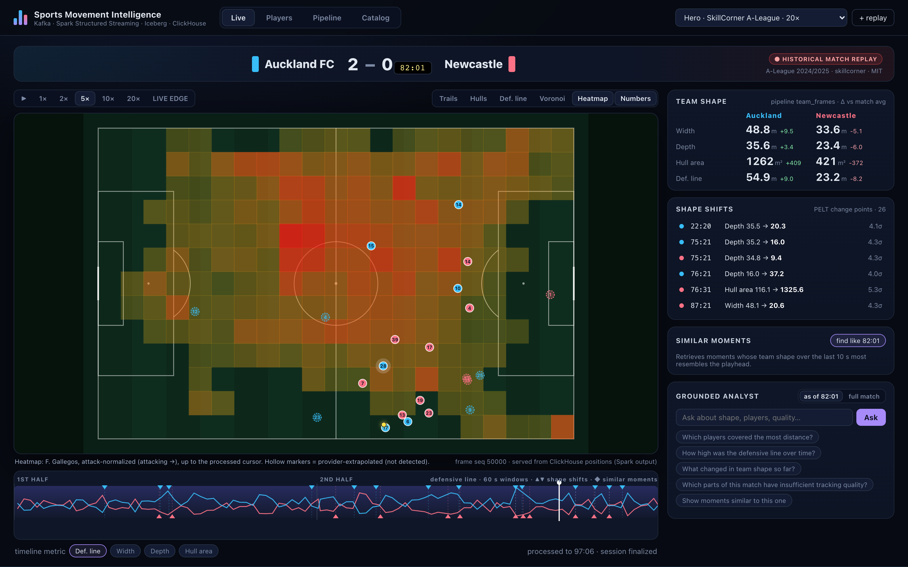
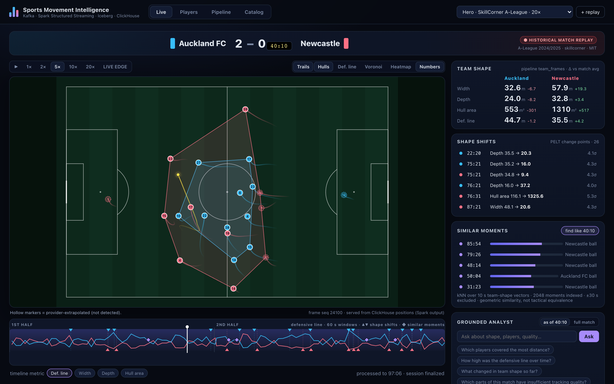
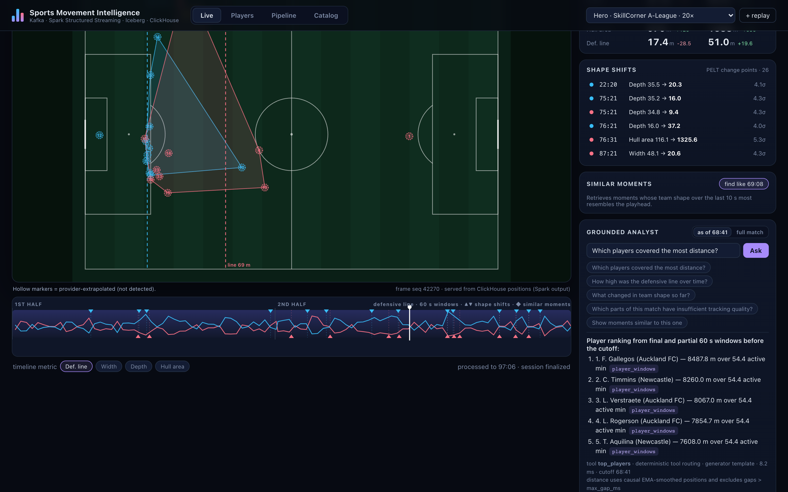
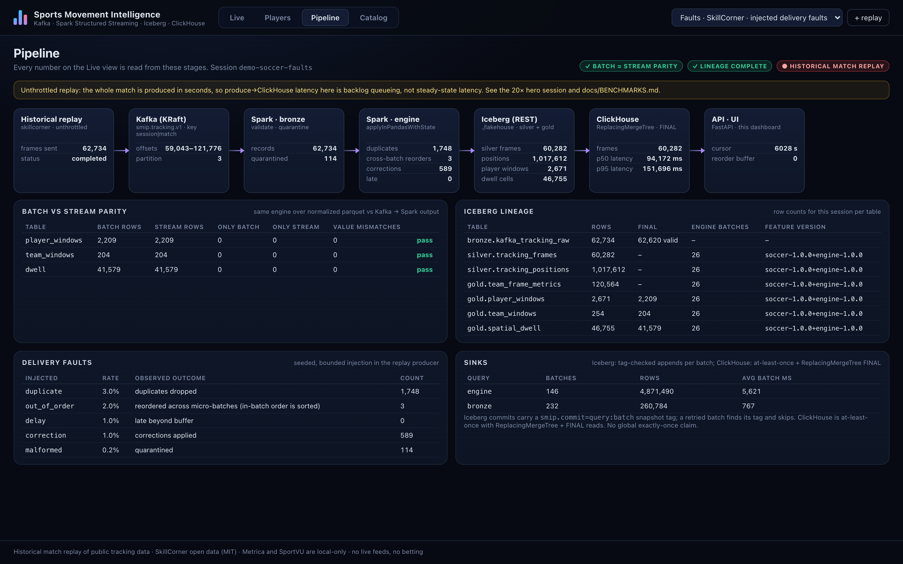
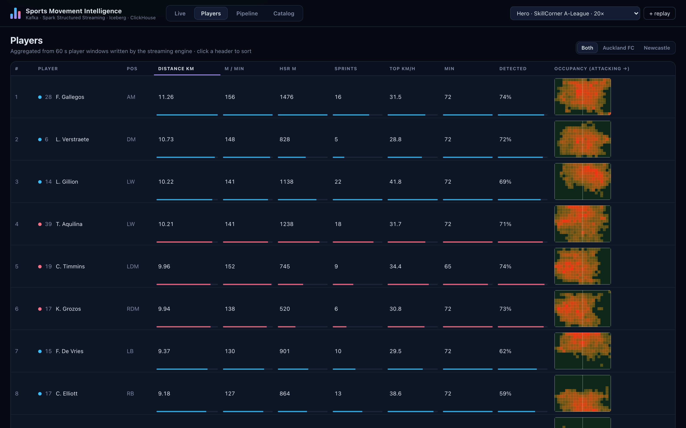
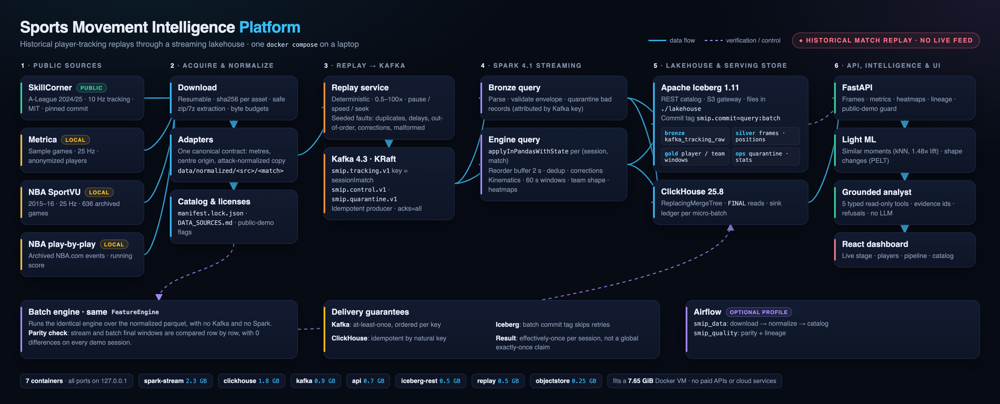
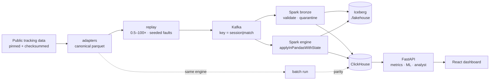

# Sports Movement Intelligence Platform

Historical player-tracking data replayed through a real streaming lakehouse, and turned into tactical views
you can scrub, question and verify.

**Stack:** Kafka → Spark Structured Streaming → Apache Iceberg → ClickHouse → FastAPI → React, all in one
`docker compose` on a laptop. **Data:** SkillCorner open data (MIT) for the public demo, with Metrica and NBA SportVU local only.



> Every session is a **historical match replay**, not a live feed. Every number in this README was measured
> by a command in this repo (see [docs/STATUS.md](docs/STATUS.md) and [docs/BENCHMARKS.md](docs/BENCHMARKS.md)).

## What it shows

| | |
|---|---|
|  |  |
| **Geometric Voronoi**: nearest-player regions (explicitly *not* pitch control) | **Player heatmap**: time-weighted occupancy, bounded by the replay cursor |
|  |  |
| **Similar moments**: kNN over team-shape vectors, 1.48× lift over random | **Grounded analyst**: typed read-only tools, evidence ids, refusals |
|  |  |
| **Pipeline under injected faults**: duplicates, corrections and quarantine, with exact parity | **Players**: distance, HSR, sprints, mini occupancy maps |

More views: [catalog and licenses](docs/img/catalog.png) and [NBA SportVU court (local only)](docs/img/live-nba.png).

## Architecture





A single `FeatureEngine` runs in both the stream (inside `applyInPandasWithState`) and batch mode. Parity
compares their final windows row by row. Details: [ARCHITECTURE](docs/ARCHITECTURE.md) ·
[CLOCKS](docs/CLOCKS.md) · [METRICS](docs/METRICS.md) · [FAILURE_SEMANTICS](docs/FAILURE_SEMANTICS.md).

## Measured on an Apple M3 laptop (Docker VM 7.65 GiB)

| | result |
|---|---|
| batch/stream parity (hero, faults, NBA sessions) | **exact**: 0 differing rows across player windows, team windows and dwell |
| faults session (3% duplicates, 1% corrections, 2% out-of-order, 1% delay, 0.2% malformed) | 1,748 duplicates dropped, 589 corrections applied, 114 records quarantined; parity still exact |
| end-to-end, unthrottled (59,042 frames) | 168 s produce → finalized (351 frames/s; ~35× real time at 10 Hz) |
| batch engine, same code | 3,391 frames/s |
| paced latency at 20× (produce → ClickHouse) | p50 3.4 s · p95 6.3 s (2 s trigger) |
| similar-moments lift (SkillCorner) | 1.48 and 1.44 over random |
| analyst eval | 15/15 |

The single-machine limits are listed in [docs/STATUS.md](docs/STATUS.md#known-limitations).

## Quickstart

Requirements: Docker Desktop with about 8 GB of memory, Python 3.12, Node 22 and `make`.

```bash
make setup                 # .venv with all extras
make data                  # sample profile: download, verify, normalize, catalog (~550 MB)
make build && make up      # core stack; http://127.0.0.1:18000
make demo-seed             # hero (20×), faults and NBA sessions, each checked for parity + lineage (~12 min)
make verify                # end-to-end gate; writes the result into docs/STATUS.md
```

Useful targets:

| target | what it does |
|---|---|
| `make ml-eval` | similar-moments lift and change points for the three demo sessions |
| `make analyst-eval` | the analyst's 15-case evaluation set |
| `make bench` | re-measures `docs/BENCHMARKS.md` |
| `make screenshots` | retakes `docs/img` |
| `make airflow` | optional orchestration profile |
| `make reset` | wipes stream state, the lakehouse and ClickHouse; keeps raw data |

For a public recording, run with `SMIP_PUBLIC_DEMO=1`. This hides every dataset whose license is unknown. See
[YOUTUBE_RUNBOOK](docs/YOUTUBE_RUNBOOK.md).

## Data and licenses

| source | use | license |
|---|---|---|
| [SkillCorner open data](https://github.com/SkillCorner/opendata) | public demo | MIT (credit SkillCorner) |
| [Metrica sample data](https://github.com/metrica-sports/sample-data) | local only, anonymized | not stated |
| NBA SportVU 2015–16 ([archive](https://github.com/linouk23/NBA-Player-Movements)) | local only | not stated |

Raw data is never committed. The license of a downloader's code is not treated as a data license. The full
registry, with checksums and caveats, is in [docs/DATA_SOURCES.md](docs/DATA_SOURCES.md).

## Docs

- **Status:** [STATUS](docs/STATUS.md), [BENCHMARKS](docs/BENCHMARKS.md)
- **Design:** [ARCHITECTURE](docs/ARCHITECTURE.md), [CLOCKS](docs/CLOCKS.md), [METRICS](docs/METRICS.md), [FAILURE_SEMANTICS](docs/FAILURE_SEMANTICS.md)
- **Model cards:** [similar moments](docs/MODEL_CARDS/similar-moments-knn.md), [shape change points](docs/MODEL_CARDS/shape-change-pelt.md), [grounded analyst](docs/MODEL_CARDS/grounded-analyst.md)
- **Operations:** [YOUTUBE_RUNBOOK](docs/YOUTUBE_RUNBOOK.md), [AWS_MAPPING](docs/AWS_MAPPING.md), [TROUBLESHOOTING](docs/TROUBLESHOOTING.md)

## Adding new games

Raw / normalized match files are **not** in git (see `.gitignore`). After you clone, download only what you need.

### 1. One-time setup (if you have not already)

```bash
make setup
make build && make up          # Kafka, Spark, Iceberg, ClickHouse, API
```

### 2. See what you can download

```bash
.venv/bin/smip sources available --only skillcorner
.venv/bin/smip sources available --only skillcorner --search auckland
.venv/bin/smip sources available --only sportvu --search TOR
```

Status column:

| status | meaning |
|---|---|
| `-` | not downloaded yet |
| `downloaded` | raw on disk — run normalize next |
| `ready: <match_id>` | normalized — ready to replay |

SkillCorner keys look like `2017461`. SportVU keys look like `01.01.2016.NYK.at.CHI`.

### 3. Download → normalize → catalog

```bash
# one or more games (comma-separated keys from the list above)
.venv/bin/smip sources download --match 2017461,1996436

# or the default sample pack (~550 MB): SkillCorner demos + a couple of NBA games
make data

.venv/bin/smip sources normalize
.venv/bin/smip sources catalog     # SportVU: also pulls the running score when available
```

### 4. Replay into the pipeline

Stack must be up (`make up`). Then either:

```bash
.venv/bin/smip replay start \
  --match skillcorner:2017461 \
  --speed 20 \
  --session my-auckland-game
```

or open http://127.0.0.1:18000 and use **+ replay** in the UI.

Match ids look like `skillcorner:2017461` or `sportvu:0021500438` (provider + game id).

### 5. Optional: parity check

```bash
.venv/bin/smip parity --session my-auckland-game --match skillcorner:2017461
```

### Notes

- **Disk:** a single SkillCorner match is roughly tens of MB normalized; SportVU raw JSON can be ~100 MB per game. Keep `data/` local — never commit it.
- **Licenses:** SkillCorner open data is MIT (credit SkillCorner). Metrica and NBA SportVU have no clear data license — fine for local use; hide them in public demos with `SMIP_PUBLIC_DEMO=1`.
- **More detail:** [docs/DATA_SOURCES.md](docs/DATA_SOURCES.md).
