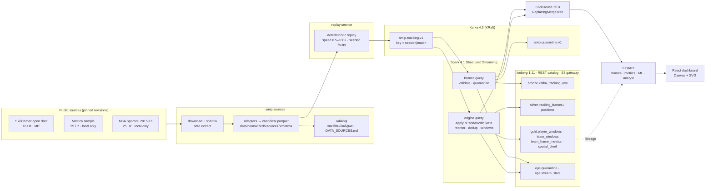

# Architecture

Every replay here is a **historical match replay** of public tracking data. There is no live feed.

The source for this image is [diagrams/architecture.html](diagrams/architecture.html). Re-render it with `make diagram`.
An animated, clickable version (replay speed, fault injection, component inspector) is in
[diagrams/architecture-live.html](diagrams/architecture-live.html). Open it in a browser.

## Components

| layer | what it does | where |
|---|---|---|
| acquisition | resumable download, checksums, zip/7z extraction with path and size guards, license registry | `smip/sources/` |
| adapters | SkillCorner, Metrica, SportVU → one canonical contract (meters, centre origin, attack-normalized copy) | `smip/sources/adapters/` |
| replay | re-emits normalized frames through Kafka on a replay clock; seeded, bounded faults | `smip/replay/` |
| bronze query | parses every Kafka record, validates the envelope, writes bronze + quarantine | `smip/spark/stream_job.py` |
| engine query | per `(session, match)` state: reorder buffer, dedup, corrections, kinematics, windows | `smip/features/engine.py` |
| batch engine | the same engine class over normalized parquet, used for parity | `smip/features/batch.py` |
| lakehouse | Iceberg tables as plain files under `./lakehouse/data/warehouse` | `smip/spark/tables.py`, `smip/lakehouse.py` |
| serving | ClickHouse tables read with `FINAL`; FastAPI endpoints | `sql/clickhouse/`, `smip/serving/` |
| ML | similar moments (kNN), shape change points (PELT) | `smip/ml/` |
| analyst | deterministic router over five typed read-only tools | `smip/analyst/` |
| orchestration | optional Airflow profile: `smip_data`, `smip_quality` DAGs | `dags/`, compose profile `orchestration` |

## One engine, two runtimes

`FeatureEngine` is plain Python/numpy. The stream job wraps it in `applyInPandasWithState` keyed by
`(replay_session_id, match_id)`; the batch job feeds it the normalized parquet directly. `smip batch parity`
compares final windows from both paths row by row. The demo sessions pass with zero differences
(see `docs/STATUS.md`).

## Resource envelope

Everything runs in one Compose file on a 7.65 GiB Docker VM. Memory limits are set per container
(Spark 2300m, ClickHouse 1800m, Kafka 900m, API 700m, …). Airflow is behind the `orchestration`
profile because the full stack plus Airflow does not fit; its DAGs were verified with `spark-stream` stopped.

## Ports (all bound to 127.0.0.1)

| service | port |
|---|---|
| API + dashboard | 18000 |
| ClickHouse HTTP | 18123 |
| Kafka (host listener) | 19092 |
| Iceberg REST | 18181 |
| S3 gateway / web UI | 17070 / 17071 |
| Spark UI | 14040 |
| Airflow (profile) | 18080 |
